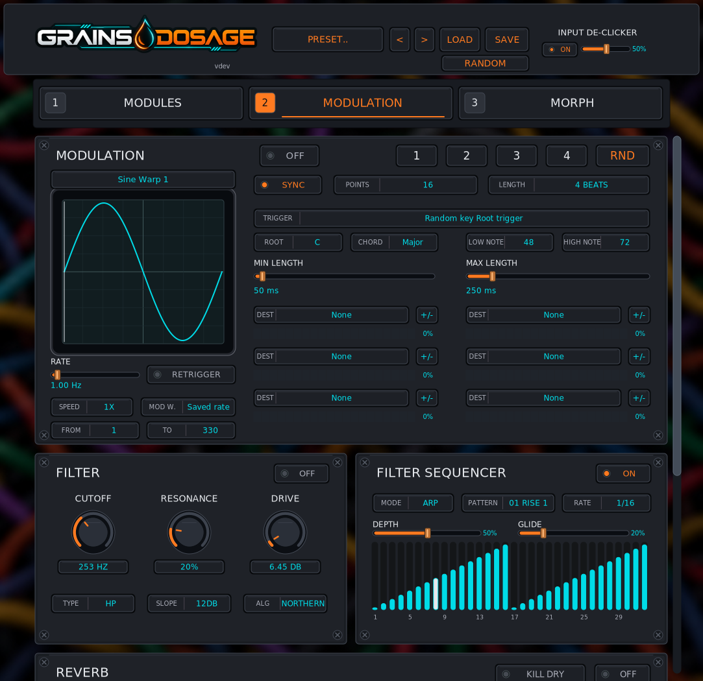

# RND modulation generator

The Modulation page has five selectors: **1, 2, 3, 4, RND**. RND is off by
default in new and older presets. It has its own wave selection (all 330 waves),
clock, wave-randomization range, and six destinations with amount/polarity.

## Root/chord triggering

Select **Random key Root trigger**, a root from C to B, and **Major** or **Minor**.
Wave height maps linearly to the inclusive **Low Note / High Note** range (MIDI
note numbers, default 48–72). Entering a new note bin fires only if its pitch
class is the root, major/minor third, or fifth. Octaves repeat the same triad.
Remaining in one note bin does not fire repeatedly; leaving and re-entering does.
The waveform is a control signal, not an audio pitch detector or MIDI generator.
A discontinuous waveform tests the note it lands on, without synthesizing extra
triggers for skipped bins. Reversed note bounds are ordered automatically.

## Gater triggering

Select **Gater steps**. Each active step of the enabled Gater can fire RND;
**Every N Steps** selects every Nth active step, starting with the first one.
The source follows the Gater's actual randomized step state and clock. Muted steps
and stopped transport produce no Gater triggers. The event reaches RND one audio
sample later, avoiding a same-sample feedback dependency when RND targets Gater
parameters. Step length and sustain continue to control the Gater audio envelope;
RND has independent pulse lengths.

## Output and timing

Each trigger draws a bipolar random level and a uniformly random duration between
**Min Length / Max Length** (5–2000 ms). Reversed length bounds are ordered.
A new trigger restarts the pulse. Short two-millisecond ramps smooth level changes
and pulse boundaries. Between pulses all routes, including positive/negative
polarity routes, return to zero modulation. Destination amounts set modulation
strength. The existing host Depth parameter remains usable for automation.

Sync/Length, Free Rate, Speed, Retrigger, and the wave randomizer control the source
LFO. The source scans at full height regardless of output Depth. Output overlays
include the fifth modulator. Random values are deterministic after reset; seeking
backward resets the pulse sequence. Processing uses fixed storage and no audio
thread allocation, I/O or additional background threads.

## Compatibility and validation

Existing parameter IDs retain their original values. Fifth-modulator parameters
are appended. State revision `0x51473151` saves the new tail; the previous
`0x51473150` boundary is explicitly retained, and older sessions leave RND disabled.
User preset files round-trip the new settings without deleting existing presets.

Tests cover triads for every root, pulse duration bounds, held-note suppression,
Gater step edges, unipolar silence, route/parameter independence, preset round trips,
and both RND layouts. Existing GUI tests exercise all five tabs. Native macOS and
Windows host validation is still required before publishing binaries.

Validation on Linux: all 37 CTest suites passed; the final RND test and Steinberg
VST3 validator were rerun after the Gater counter fix (47 validator checks passed).
All 192 pre-existing named parameter IDs were compared with the previous revision
and match. No GitHub workflows were dispatched.

